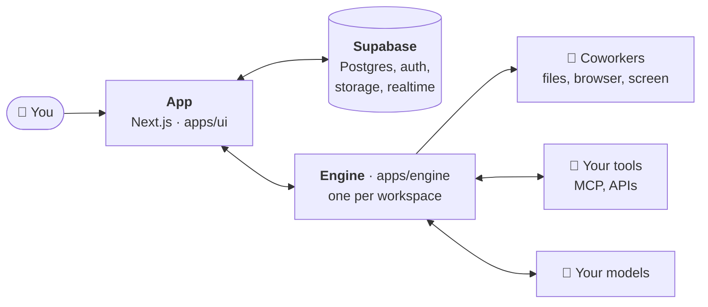

<p align="center">
  <picture>
    <source media="(prefers-color-scheme: dark)" srcset=".github/assets/banner-night.jpg">
    
  </picture>
</p>

<h1 align="center">Rerun</h1>

<p align="center">
  <strong>Hire AI coworkers for your team.</strong><br />
  They use your tools, work on a schedule, and check with you before anything that matters.
</p>

<p align="center">
  <a href="LICENSE"></a>
  <a href="https://github.com/rerun-build/rerun/actions/workflows/ci.yml"></a>
  <a href="https://github.com/rerun-build/rerun/releases"></a>
  <a href="https://github.com/rerun-build/rerun/stargazers"></a>
  <a href="https://discord.gg/cJUUgdTg5p"></a>
</p>

<p align="center">
  <a href="https://docs.rerun.build/self-host"><strong>Host it yourself »</strong></a>
  <br />
  <br />
  <a href="https://docs.rerun.build">Docs</a>
  ·
  <a href="https://rerun.build">Rerun Cloud</a>
  ·
  <a href="https://discord.gg/cJUUgdTg5p">Discord</a>
  ·
  <a href="CONTRIBUTING.md">Contributing</a>
</p>

<br />

<p align="center"><strong>Your coworkers work in:</strong></p>
<p align="center">
  
  
  
  
  
  
  <br />
  
  
  
  
  
  
  <br />
  
  
  
  
  
  
</p>
<p align="center"><sub>and 200+ more in the catalog, any MCP server, 2,000+ apps through Composio</sub></p>

<p align="center"><strong>On the models you pick:</strong></p>
<p align="center">
  
  
  
  
</p>
<p align="center"><sub>an API key, the Claude or ChatGPT subscription you already pay for, or your own model through Ollama, LM Studio, vLLM or any OpenAI-compatible server</sub></p>

<br />

## 👋 Meet your new team

You tell Rerun what you need done, in plain words. The **Foreman** interviews you, plans a team and
builds it. Each coworker gets a job, its own memory, its own skills and its own computer. You see
them all on one board, you talk to any of them like to a colleague, and they ask before they send,
pay or delete anything.

<p align="center">
  
</p>

A few coworkers people hire on day one, each a ready-made template:

<table>
  <tr>
    <td width="33%" valign="top">
      <a href="https://rerun.build/templates/executive-assistant?utm_source=github&amp;utm_medium=readme"></a><br />
      <a href="https://rerun.build/templates/executive-assistant?utm_source=github&amp;utm_medium=readme"><strong>Executive Assistant</strong></a><br />
      <sub>Sorts your inbox, clears your calendar, briefs you every morning</sub>
    </td>
    <td width="33%" valign="top">
      <a href="https://rerun.build/templates/data-analyst?utm_source=github&amp;utm_medium=readme"></a><br />
      <a href="https://rerun.build/templates/data-analyst?utm_source=github&amp;utm_medium=readme"><strong>Data Analyst</strong></a><br />
      <sub>Answers your questions from your data, with charts and a weekly KPI report</sub>
    </td>
    <td width="33%" valign="top">
      <a href="https://rerun.build/templates/online-reputation-manager?utm_source=github&amp;utm_medium=readme"></a><br />
      <a href="https://rerun.build/templates/online-reputation-manager?utm_source=github&amp;utm_medium=readme"><strong>Reputation Manager</strong></a><br />
      <sub>Watches your reviews and your competitors, drafts every reply</sub>
    </td>
  </tr>
  <tr>
    <td width="33%" valign="top">
      <a href="https://rerun.build/templates/sales-development-rep?utm_source=github&amp;utm_medium=readme"></a><br />
      <a href="https://rerun.build/templates/sales-development-rep?utm_source=github&amp;utm_medium=readme"><strong>Sales Development Rep</strong></a><br />
      <sub>Finds prospects who fit and writes each one a first email</sub>
    </td>
    <td width="33%" valign="top">
      <a href="https://rerun.build/templates/social-media-manager?utm_source=github&amp;utm_medium=readme"></a><br />
      <a href="https://rerun.build/templates/social-media-manager?utm_source=github&amp;utm_medium=readme"><strong>Social Media Manager</strong></a><br />
      <sub>Writes a week of posts for each network, publishes when you say go</sub>
    </td>
    <td width="33%" valign="top">
      <a href="https://rerun.build/templates/collections-officer?utm_source=github&amp;utm_medium=readme"></a><br />
      <a href="https://rerun.build/templates/collections-officer?utm_source=github&amp;utm_medium=readme"><strong>Collections Specialist</strong></a><br />
      <sub>Chases every late invoice, without the awkward emails</sub>
    </td>
  </tr>
</table>

## ✨ Features

<p align="center">
  
</p>

**🧑‍✈️ The Foreman runs your team.** Say what you need, out loud if you like. It spots what needs doing,
hires the coworker for it, and answers your coworkers by your rules while you are away.

<table>
  <tr>
    <td width="50%" valign="top">
      <br />
      <strong>🖥️ Their own computer</strong><br />
      <sub>A browser and a screen you can watch, and take over at any time</sub>
    </td>
    <td width="50%" valign="top">
      <br />
      <strong>✋ You stay in charge</strong><br />
      <sub>They stop and ask before they send, pay or delete anything</sub>
    </td>
  </tr>
  <tr>
    <td width="50%" valign="top">
      <br />
      <strong>⏰ Work while you sleep</strong><br />
      <sub>Schedules and webhook triggers: the 7am run happens without you</sub>
    </td>
    <td width="50%" valign="top">
      <br />
      <strong>🤝 They work together</strong><br />
      <sub>One finds the leads, the next writes to them, a third files the result</sub>
    </td>
  </tr>
</table>

And everything else a colleague needs:

- 🧠 **Coworkers that remember**: a soul, skills, a memory that grows with every task
- 🗺️ **One board**: every coworker, every Box and every running task in sight
- 💬 **Chat like with a colleague**: files, voice notes, tables and approvals inline
- 🔌 **Plugs into everything**: 200+ ready integrations, any MCP server, Composio
- 🏠 **Your own servers**: attach the machine your coworkers run on in one command
- ♾️ **No limits**: as many coworkers and seats as you want, nothing to pay

## 🚀 Quick start

Let an AI install it for you:

<p align="center">
  <a href="https://claude.ai/new?q=Install%20Rerun%2C%20the%20open%20source%20AI%20coworkers%20app%2C%20for%20me.%20Follow%20the%20guide%20written%20for%20AI%20assistants%3A%20https%3A%2F%2Fraw.githubusercontent.com%2Frerun-build%2Frerun%2Fmain%2FINSTALL.md"></a>
  <a href="https://chatgpt.com/?q=Install%20Rerun%2C%20the%20open%20source%20AI%20coworkers%20app%2C%20for%20me.%20Follow%20the%20guide%20written%20for%20AI%20assistants%3A%20https%3A%2F%2Fraw.githubusercontent.com%2Frerun-build%2Frerun%2Fmain%2FINSTALL.md"></a>
</p>

Or paste this into Claude Code, Codex or Cursor, which run the commands for you:

```text
Install Rerun, the open source AI coworkers app, for me. Follow the guide written for AI assistants: https://raw.githubusercontent.com/rerun-build/rerun/main/INSTALL.md
```

By hand, you need Docker, Node.js 22, and a Supabase project (a free one on [supabase.com](https://supabase.com) works).

```bash
git clone https://github.com/rerun-build/rerun.git && cd rerun
cp .env.example .env          # fill the Supabase URL and keys, and an OpenRouter key
npx supabase link --project-ref <your-project-ref> && npx supabase db push --include-seed
node scripts/self-host-check.mjs
docker compose up -d --build  # then open http://localhost:3000
```

That's it, say hi to the Foreman. 🎉

The [self-hosting guide](https://docs.rerun.build/self-host) walks through every step, including
Supabase on your own machine, adding servers, HTTPS and updates.

## ☁️ Open source or Rerun Cloud?

Same product, same code. Rerun Cloud is this Rerun, hosted, plus what only a hosted service can offer.

| | 🛠️ Open source | ☁️ Rerun Cloud |
|---|---|---|
| Coworkers, chat, memory, skills, schedules | ✅ | ✅ |
| Services catalog, MCP, Composio | ✅ | ✅ |
| Template library | Your own templates | ✅ |
| A computer for each workspace | You host it, one command attaches it | Ready in 30 seconds |
| AI models | Your keys or subscriptions | Included credit, or your keys |
| Premium features (LinkedIn, WhatsApp, paid data, emails) | | ✅ |
| Updates | Each release | Continuous |
| Support | Community | ✅ |
| Price | Free forever | [See plans](https://rerun.build/pricing) |

## 💜 Our partners

Part of Rerun Cloud runs on two partners: LinkedIn, WhatsApp and paid data. Their integrations
live in this repository, in the open.

<table>
  <tr>
    <td width="50%" valign="top">
      <a href="https://treg.to"></a><br />
      <a href="https://treg.to"><strong>Treg</strong></a><br />
      <sub>One key for 4,100+ data tools across 126 providers, paid per call</sub>
      <br /><br />
      Powers <strong>paid data</strong>. A coworker finds people and leads, companies, search results, SEO
      figures and public profiles on LinkedIn, TikTok, Instagram, X, YouTube, Facebook and Reddit,
      all through one <code>paid_data</code> tool. Treg picks the provider and tries the next one on a miss.
      <br /><br />
      <sub><code>apps/ui/lib/paid-data</code> · <code>packages/contracts/src/paid-data.ts</code></sub>
    </td>
    <td width="50%" valign="top">
      <a href="https://linkupapi.com"></a><br />
      <a href="https://linkupapi.com"><strong>Linkup</strong></a><br />
      <sub>The outreach API for AI agents: LinkedIn, email, WhatsApp, iMessage</sub>
      <br /><br />
      Powers the <strong>LinkedIn and WhatsApp apps</strong>. A coworker gets a real account: it searches
      people, sends invitations and messages, posts and comments, and wakes up the moment someone
      replies or accepts.
      <br /><br />
      <sub><code>apps/ui/lib/apps/linkup</code> · <code>apps/ui/lib/apps/linkedin</code> · <code>apps/ui/lib/apps/whatsapp</code></sub>
    </td>
  </tr>
</table>

## 🎓 Rerun Experts

Need a coworker built around your business, or a hand to set Rerun up? Rerun Experts are vetted
builders, freelancers and studios who design, ship and run AI coworkers on Rerun.

<table>
  <tr>
    <td width="50%" valign="top">
      <a href="https://rerun.build/community/experts?utm_source=github&amp;utm_medium=readme"><strong>🔎 Hire an expert</strong></a><br />
      <sub>Browse the directory by skill and location, and send your request from the site</sub>
    </td>
    <td width="50%" valign="top">
      <a href="https://rerun.build/community/experts/program?utm_source=github&amp;utm_medium=readme"><strong>🛠️ Become an expert</strong></a><br />
      <sub>Get listed, build for your clients in a free sandbox, keep 95% of your template sales and earn 20% on every client you bring</sub>
    </td>
  </tr>
</table>

## 🧩 How it fits together



**Built with** Next.js, React, Tailwind, Supabase, the Vercel AI SDK, Hono, libSQL, Patchright and Docker,
in a pnpm monorepo.

## 🤝 Contributing

Bug reports, fixes and docs are welcome. Read [CONTRIBUTING.md](CONTRIBUTING.md) first: it explains
how to run Rerun from source and how pull requests flow back into Rerun Cloud.

Self-hosted installs get community support on GitHub: an issue without logs or steps to reproduce
is closed with a link to the guide. Questions and show-and-tell go to [Discord](https://discord.gg/cJUUgdTg5p).

If Rerun saves you a few hours, a ⭐ helps a lot.

<p align="center">
  <a href="https://star-history.com/#rerun-build/rerun&Date">
    <picture>
      <source media="(prefers-color-scheme: dark)" srcset="https://api.star-history.com/svg?repos=rerun-build/rerun&type=Date&theme=dark">
      
    </picture>
  </a>
</p>

## 📜 License

[AGPL-3.0](LICENSE). You can run, modify and host Rerun freely; if you host it for others, you
publish your changes under the same license. The name and logo are not covered: see
[TRADEMARK.md](TRADEMARK.md).

This fork carries no billing code: the `ee` and `(ee)` directories of upstream (billing and plans,
the Rerun credit, the template marketplace) are removed.
