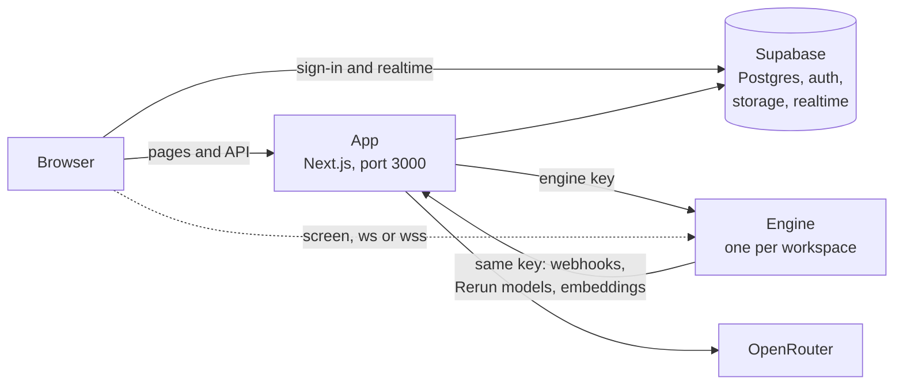

Rerun is an app of AI coworkers. You tell it what you need done, its guide (the Chief of Staff) sets up a team of coworkers, and each one works with your tools, on a schedule or when you message it, and checks with you before anything that matters.

The open source build is the same product Rerun Cloud runs, licensed under AGPL-3.0, for you to host. No plan, no credit, no limit on coworkers or seats.

<CardGroup cols={2}>
  <Card title="Install it" icon="rocket" href="/self-host/install">
    One `docker compose` command, about ten minutes.
  </Card>
  <Card title="Open source or Cloud" icon="scale" href="/self-host/open-source-vs-cloud">
    What the open source build leaves out, and how to get the equivalent.
  </Card>
</CardGroup>

## The three pieces

**The app** is the website people open: the board, the chats, the settings. It is a Next.js server (`apps/ui`) listening on port 3000. It also holds the API the engines call back.

**Supabase** is the database behind the app: Postgres for the data, its auth for sign-in, its storage for uploaded files, its realtime for live updates. You use a project on supabase.com or run it on your own machine.

**The engine** is where the coworkers actually work (`apps/engine`). Each workspace has exactly one. It runs every coworker of that workspace with its tools, memory, files and schedules, plus a Chromium browser and a desktop screen (Xvfb and x11vnc) people can watch. It listens on port 3000 inside its container.

## How they talk

- The browser talks to the app, and directly to Supabase for sign-in and live updates. That is why the Supabase address must work from the browser too.
- The app calls the engine with the engine's key. The engine calls the app back at `RERUN_HUB_BASE_URL` with the same key: to report what happened in a run, to reach the Rerun models, to compute embeddings.
- The desktop screen is the one exception: the browser opens it directly on the engine's address, over `ws://` or `wss://`.
- The app reaches OpenRouter with your key for the Chief of Staff's onboarding and the [Rerun models](/self-host/models).

## What runs where

`docker compose up` starts two containers on one machine: the app, and the engine of your first workspace. That is enough for a person or a small team.

Every other workspace needs a server of its own. You start the engine image on any machine with Docker, and it attaches itself to the workspace from the app. See [Servers](/self-host/servers).

| Piece | Where it runs | Port |
| --- | --- | --- |
| App | `app` container, from `apps/ui/Dockerfile` | 3000, published as `RERUN_APP_PORT` |
| Engine of the first workspace | `engine` container next to the app, from `apps/engine/Dockerfile` | 3000 inside Docker, published as `RERUN_ENGINE_PORT` (3001) |
| Engines of other workspaces | Any machine, image `ghcr.io/rerun-build/rerun-engine:latest` | 3000 |
| Supabase | supabase.com, open source on your server, or `npx supabase start` on your computer | 8000 on your server, 54420 to 54429 locally |

## What is stored where

| Where | What |
| --- | --- |
| **Supabase** | Accounts, workspaces and members, the coworkers' names, handles and Boxes, invitations, notifications, the services catalog, files the app stores, the list of servers and their keys |
| **The engine data-dir** (`/data`, volume `engine-data`) | Everything a coworker knows and does: its soul, settings, skills, memories, files, private database, conversations, scheduled tasks, plus the shared folder, the shared database, and the credentials of its apps and AI providers |

The data-dir is a plain folder of files and SQLite databases. Credentials stay there and never go to Supabase. Back up both places: see [Backups](/self-host/servers#backups).

## What you need

- A machine with Docker and Docker Compose. Building the images needs about 6 GB of memory available to Docker.
- A Supabase project, free on [supabase.com](https://supabase.com), or Supabase running on the same machine.
- An [OpenRouter key](https://openrouter.ai/keys), for the Chief of Staff's onboarding and the default models. Optional if you connect your own AI.
- Node.js 22, for two small setup commands.

## Next steps

<CardGroup cols={3}>
  <Card title="Install" icon="download" href="/self-host/install" horizontal />
  <Card title="Configuration" icon="settings" href="/self-host/configuration" horizontal />
  <Card title="Add a server" icon="server" href="/self-host/servers" horizontal />
</CardGroup>
