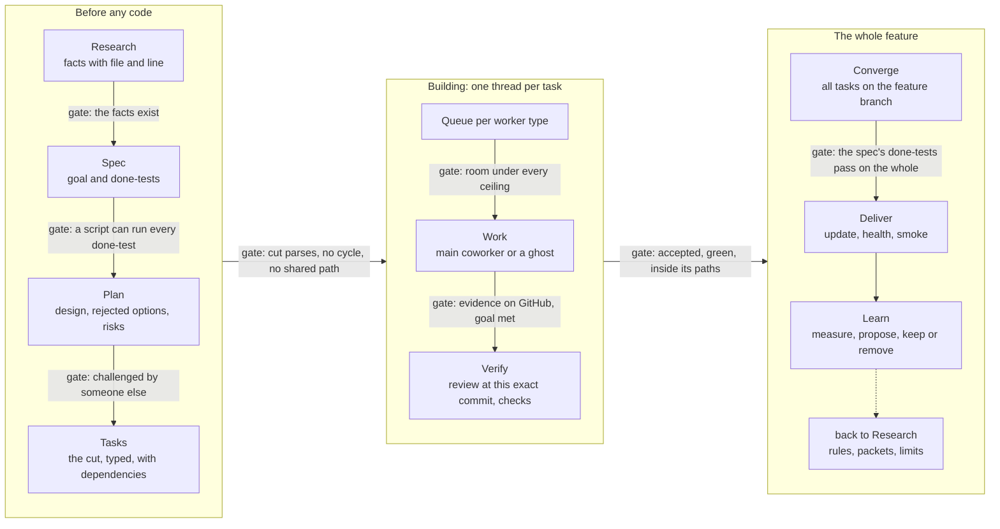
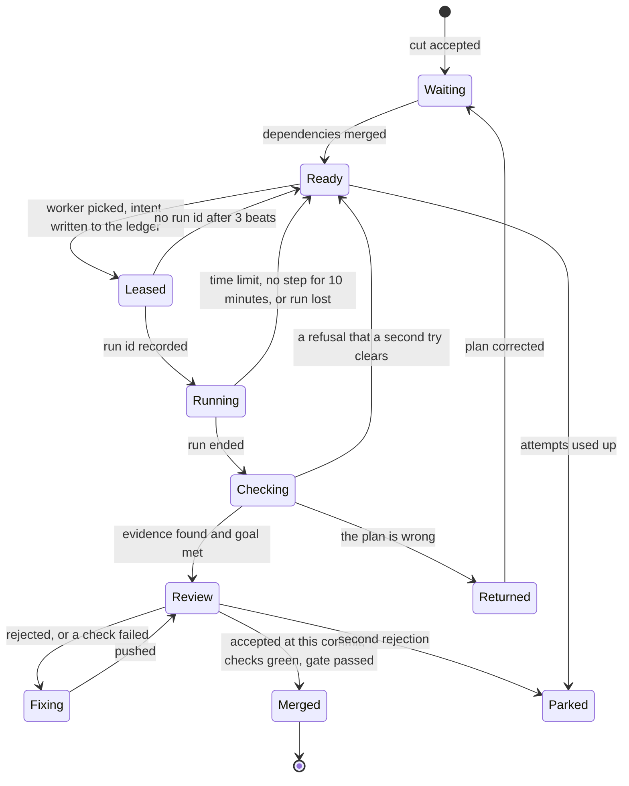
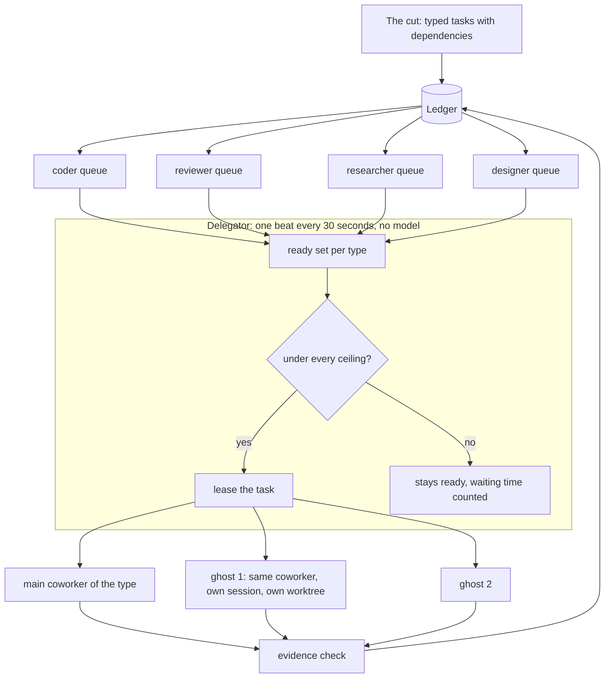
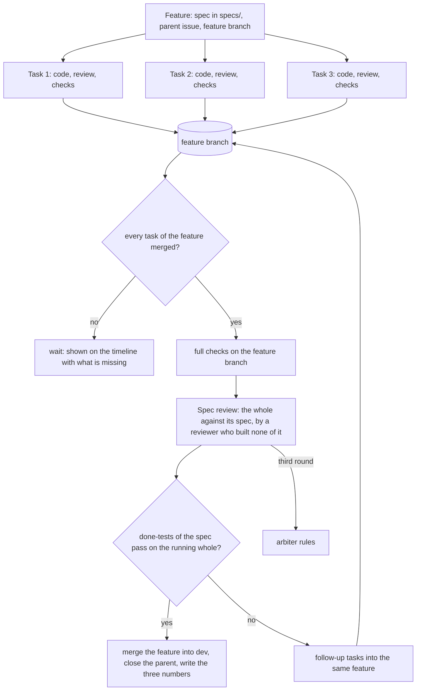

# The factory machine: pipelines, queues, threads, heartbeat and gates

Rob, 2026-11-13: "all I ask you to devise all the loops, workflows, queuing mechanisms, thread tracking, heartbeat
mechanism, gating mechanisms.... everything needed by a software factory to work as a well oiled machine" and
"construct the factory pipelines as a diagram logic if you must, something that can be visualized easy".

This page is the operating design. [PRINCIPLES.md](PRINCIPLES.md) holds the rules it follows, [MAP.md](MAP.md) the
parts, [LOOPS.md](LOOPS.md) every loop and gate with its state in the code. The plan to build it is issue #198.

Status on 2026-11-13: design. What runs today is marked in each table. Code facts were read on `dev` at `a4358ed`.

## 1. The machine in one paragraph

One **delegator** process wakes on a fixed beat. Work reaches it as **typed tasks** with dependencies, cut from a plan.
It keeps one **queue per worker type**, leases each ready task to that type's main coworker or to a **ghost** (a second
run of the same coworker), and never believes a worker's own words: a task ends when **evidence** on GitHub and the
run's goal say so. Every lease has a **time limit**, so a silent worker loses its task and the task goes back in the
queue. The tasks of one feature **converge** on a feature branch, where the whole is checked against its spec before it
reaches `dev`. **Gates** are refusals in code at the places work already passes through. Every state change is a row
in one **ledger**, which is also where the timeline and the numbers come from.

Three findings from outside decided three of these lines:

| Finding | Source | What it decided here |
|---|---|---|
| Many agents help on work that splits and hurt on work that is one chain: +81% on a parallel task, -39% to -70% on a sequential one, across 180 set-ups | Google Research, "Towards a science of scaling agent systems" | Ghosts follow the **ready set**, never the total. A chain of dependent tasks gets one worker, and the chunker is measured on how wide it cuts. |
| An orchestrator with parallel workers is the shape that works; such systems use about 15 times the tokens of a chat, and token use explains most of the result | Anthropic, "How we built our multi-agent research system" | One delegator in code (no model), workers by type, and a **ceiling** on ghosts tied to the weekly allowance. |
| A task queue tells a crashed worker from a slow one with three clocks: time waiting to start, time for one attempt, and a heartbeat | Temporal, "Detecting activity failures" | Every lease carries the three clocks of section 6. A task whose worker went silent is leased again, once, under a new attempt number. |

## 2. The line

Six stages, as Rob named them: research, spec, plan, task, work, verify. Then the whole converges, is delivered, and
the line learns. The text on an arrow is the gate between two stages: code that refuses.

Each stage is a typed task with its own queue. What one stage produces is what the next stage's task points at: the
research note, the spec in `specs/`, the plan on the issue, the cut.

## 3. The life of one task

This is the thread. A task keeps it from the cut to the merge, whoever works on it and however many ghosts are running.

- **Leased, then Running.** The delegator writes what it is about to start before it starts it. A crash between the
  two leaves a row that the next beat resolves, instead of a lost task or a second start.
- **Back to Ready** is not a failure of the work. No room for a worktree, a rate limit, an engine restart: the task
  waits 1, 2, then 4 minutes and goes out again, to any free worker of its type.
- **Returned** is for a builder who finds the plan wrong. The task goes back to whoever cut it, and the tasks behind it
  show "waiting on a returned task" instead of sitting blocked.
- **Parked** is the only state that needs a decision. The arbiter (the Advisor coworker, fresh session, with the plan,
  the diff and both positions) rules once: try again with a change, cut again, or drop. Only what is Rob's alone goes
  to Rob.

## 4. Queues, the delegator and ghosts

- **A ghost is a second run of the same coworker.** Tried on the live server on 2026-11-13: two messages sent to one
  coworker in the same second gave two runs that started together and ran side by side. Nothing is created and
  nothing is removed. Each ghost carries a number (`copy_index`, already a column on every run) and, for coders, its
  own worktree. A real copy of a coworker is kept for the case where the shared parts collide (section 9, open point 1).
- **Load is the ready set.** Per type: tasks whose dependencies are merged and that nobody holds. The delegator starts
  `min(ready, ceiling - running)` workers of that type. With one ready task there is one worker; with six there are six.
- **Ceilings come from real limits**, in this order: free memory and disk on the server, open worktrees, the type's
  own ceiling, and the pace of the weekly allowance. A run that ends on a rate limit lowers that type's ceiling by one
  for ten minutes.
- **Starts are staggered.** At most one new worktree every few seconds, because four at once lost one on 2026-11-13.
- **The review of a task is queued the moment its code task is leased**, bound to that task. When the code arrives,
  the review is already first in the reviewer queue for it. Three coding tasks give three threads that do not mix.

## 5. Convergence

- Tasks of a feature merge into a **feature branch**, not into `dev`. A convergence that fails holds nothing back on
  `dev` and never needs a revert. A single small fix has no feature branch and goes straight to `dev`.
- The join is code: the delegator knows the tasks of a feature from the cut and queues the spec review when the last
  one merges.
- The spec review reads the spec and the whole diff, and for interface work looks at the running product. Its exit is
  the spec's own done-tests, run by CI on the integrated head.

## 6. The beat: heartbeat, clocks and what happens on each tick

One beat every 30 seconds (it exists: `poll_s`). On every beat, in this order:

| Step | What the delegator does | Clock or limit | Exists |
|---|---|---|---|
| 1 | Writes the heartbeat: the time and one line of state per type and per feature | the container's health check fails when the heartbeat is older than 2 minutes | new |
| 2 | Resolves leases with no run id | 3 beats, then the task is Ready again | idle code (`limits.resolve_pending`) |
| 3 | Reads every running run: wall time, last step, tokens | 45 minutes; 10 minutes without a step; 400,000 tokens; then the run is cancelled and the attempt counted | idle code (`limits.run_outcome`); cancelling needs an account tool |
| 4 | Checks ended runs against evidence and goal | never the run's own text alone | idle code (`evidence.py`); goal check live since #177 |
| 5 | Fills the queues: ready set per type, ceilings, leases | a ready task not started for 10 minutes with room under the ceiling is reported as starved | partly live (`queued` state); the full rule is idle code (`readyq.eligible`) |
| 6 | Watches checks of accepted tasks | waits while a check is running; gives up only when none is running and one is red, or after 60 minutes | live, with a flat 30-minute limit |
| 7 | Checks joins: features whose last task merged | queues the spec review | new |
| 8 | Saves, and prints anything that changed state | one writer, a row per change with its time | live as a JSON file; the ledger is idle code (`store.py`) |

**The timeline** is drawn from step 8's rows: every task as a bar from Ready to Merged, with its waiting, working,
review and check parts, and an arrow to what it waits on. A `status` command prints it; a screen comes later. This is
the afternoon of 2026-11-13, from GitHub's own timestamps:

```mermaid
gantt
  title Wave of 2026-11-13, times in UTC
  dateFormat HH:mm
  axisFormat %H:%M
  section Goal per run
  171 build                         :done, 18:06, 18:08
  171 review and checks             :done, 18:08, 18:16
  172 build                         :done, 18:06, 18:08
  172 review and checks             :done, 18:08, 18:14
  173 build                         :done, 18:06, 18:09
  173 review and checks             :done, 18:09, 18:21
  174 waits on 172                  :18:06, 18:15
  174 build, review, checks         :done, 18:15, 18:22
  175 waits on 172 to 174           :18:06, 18:22
  175 build, review, checks         :done, 18:22, 18:31
  176 waits on 175                  :18:06, 18:31
  176 build, review, checks         :done, 18:31, 18:42
  177 waits on 176                  :18:06, 18:42
  177 build, review, checks         :done, 18:42, 18:49
  section Picture pages
  178 refused, no room              :crit, 18:06, 18:11
  178 build                         :done, 18:11, 18:13
  178 checks behind a stale build   :crit, 18:13, 18:53
  178 stopped by the 30 minute limit :crit, 18:53, 19:10
  179 and 180 wait on 178           :18:06, 19:10
  section Skill switch
  191 build                         :done, 18:39, 18:42
  191 failed check, lock fix        :crit, 18:42, 19:04
  192 and 194 sent out of order     :crit, 18:39, 18:44
  192 waits on 191                  :18:44, 19:04
  193 build, review, checks         :done, 18:39, 18:49
  194 waits on 193                  :18:44, 18:49
  194 build, review, checks         :done, 18:49, 19:03
```

Read from it: seven goal tasks took 43 minutes because they were one chain, not because workers were missing. Every
red bar is a fault that section 8 turns into a mechanism.

## 7. Gates

A gate is a refusal in code. Each sits at a place work already passes through.

| Gate | Where | Refuses when | Exists |
|---|---|---|---|
| Cut shape | intake by the delegator | a task has no type, no dependency line the delegator's own parser reads, no done-test, no paths; the graph has a cycle; two tasks that may run together share a path | shape only, idle (`ledger.shape`) |
| Plan marker | `wt new` | no `PLAN READY` or `SMALL FIX` on the issue | live; the delegator posts the marker itself today, so it never refuses |
| Room | `wt new` | no slot, low memory, low disk | live |
| Diff inside its paths | `pr-open` | a changed file is outside the task's paths; a lockfile changes anything but the packages the task names; a workflow file; a secret | workflow files only; the path rule is idle code (`publish._outside`, `evidence.build`) |
| Evidence | delegator, step 4 | no pushed branch, no pull request, the test file is not in the diff | idle (`evidence.py`) |
| Goal | engine stop check | the answer does not end in the required form | live since #171 to #177 |
| Reviewers by risk | delegator | a diff that writes stored data, config, keys or sign-in has no verdict from the reviewer of that area | idle (`roster.required`, `risk`) |
| Verdict at this commit | merge | the pull request moved since the review | live (`--match-head-commit`) |
| Red before green | merge | the task's test never failed without the change | live only in the hand tool (`gate.py` through `merge-dev`) |
| Convergence | join | a task of the feature is not merged; a done-test of the spec fails on the whole | new |
| Deliver | update script | no snapshot, a run in progress, health check fails | snapshot merged (#169); the rest by hand |
| Nothing unsaved is deleted | `wt done`, sweep | unpushed commits, uncommitted changes | live |

## 8. What 2026-11-13 showed, and which mechanism answers each

The build order comes from here (principle 6: a part is built only when a measured failure demands it).

| # | What happened | Caught by | The mechanism that would have caught it |
|---|---|---|---|
| 1 | A copy method passed its test, its review and its checks, and failed on a real database (#169) | a scratch run by hand | Cut shape and plan review: a done-test on stored data uses data made by the engine itself. Convergence: done-tests on the running whole |
| 2 | A dependency job also changed how two other packages resolve (#178) | reading the diff by hand | Diff inside its paths: the lockfile rule |
| 3 | A job was refused for lack of room and its chain stopped (#178) | by hand: label put back | Back to Ready for refusals a second try clears; staggered starts |
| 4 | A slow image build ran into a flat 30-minute limit (#178) | by hand: label put back | Step 6: wait while a check runs. Fixed at the source too (#188) |
| 5 | Two jobs went out before what they depend on (#192, #194) | the builders refused; by hand: issues rewritten | Cut shape: parsed by the delegator's own parser at intake |
| 6 | A config writer without the lock its neighbours take (#191) | reading the diff by hand | Reviewers by risk: a data reviewer for every diff that writes config or a database |
| 7 | A plan carried two faults that would have blocked every review (#172, #173) | reading the cut by hand | Plan review by someone who did not write it, with the delegator's parser as its first check |
| 8 | Two empty worktrees left behind by blocked jobs | by hand | Cleanup: a task that ends without a commit closes its worktree |
| 9 | A run can hang and hold its worker for good | not hit yet; found by reading `dispatch.py` | Step 3: the three clocks and a cancel |

Nine faults, eight of them cleared by hand. None needed more workers.

## 9. The overlay: what exists, what is idle, what is new

The repository holds two halves of this machine that do not know each other.

- **Live:** `tools/factory/dispatch.py` (519 lines). It runs on the server, carried 30 jobs to a merge on
  2026-11-13, and keeps its state in one JSON file. It imports nothing from the other half.
- **Idle but tested:** the earlier runner. `store.py` (a ledger in SQLite: an intent row before every start, attempts,
  leases with an end time, timestamps), `readyq.py` (the one rule for "may this start": dependencies, slots, a cap per
  job, path leases), `limits.py` (the clocks and counters), `evidence.py` (what on GitHub proves a stage ended),
  `roster.py` (areas, their owners and required reviewers), `measures.py` and `status_report.py` (the numbers),
  `followups.py`, `wake.py`. Its loop, `runner_loop.py`, can only start two stub stages and builds nothing.

**The decision:** the delegator stays the one process and is seated on the idle half.

| Part of the machine | Today | Becomes | Prerequisite |
|---|---|---|---|
| State | JSON file, no history | `store.py` ledger | none; one writer already |
| May this start? | first free name, dependency check | `readyq.eligible` with types added | the worker type on every task |
| Stage ended? | the run's last line, plus the goal | `evidence.py` and the goal | none |
| Clocks | none per run | `limits.run_outcome` | an account tool to cancel a run (the engine route exists) |
| Retry | one resend | the classes of section 3, with `store.attempts` | none |
| Who reviews | first free reviewer | `roster.required` by the files in the diff | none |
| Merge | checks green, verdict, head match | the same plus `gate.py` | none |
| Ghosts | one job per named coworker | parallel runs with `copy_index` | `send_message` passes the number through; ceilings in config |
| Convergence | every task merges into `dev`; parents closed by hand | feature branch and join | `wt new --base` exists; CI must run on feature branches |
| Numbers and timeline | none | `measures.py`, `status_report.py`, the gantt of section 6 | the ledger |
| Heartbeat | none | a line per beat and a container health check | none |
| Front of the line | plans written and cut by hand through Boss | research, spec, plan as typed tasks | the stage skills; `specs/` as the place for specs |

**Deleted as this lands** (principle 6: every new part deletes something): `runner_loop.py`, `trigger.py`,
`stub_model.py`, `realmodel.py`, `batch.py` and the stub stages in `runner.json`; the JSON state file; the
`auto_plan_marker` switch; the two fixed lists of names in `dispatch.json`; the watching and label-moving that is done
by hand today.

**Open before building**

1. What parallel runs of one coworker share that could collide: the workspace folder outside worktrees, memory
   writes, the shared handoff files builders append to. Coders in worktrees and reviewers who only read are safe on
   the first two; the handoff files need an append that cannot interleave, or go away with the ledger.
2. The worker types and the main coworker of each. `roster.json` already has areas with an owner and a builder.
3. Where the weekly allowance is read from, so the ceiling can pace against it (open since issue #40).
4. Two tiers of checks: fast for a task (its named tests, type check, lint), full for the feature.

## 10. Build order

Each phase is one cut of a few tasks, ends in something a person can see, and names what it removes.

| Phase | Outcome | Contents | Answers which faults of section 8 |
|---|---|---|---|
| **A. The delegator stops losing work** | no job needs a hand to move again | ledger for state; the three clocks and cancel; retry classes; cut-shape gate at intake; heartbeat and health check; `status` with the timeline | 3, 4, 5, 8, 9 |
| **B. Queues by type and ghosts** | six ready tasks of one type start six workers | types from the roster; a queue per type; ghosts with `copy_index`; ceilings; staggered starts; the review queued with its code task | throughput on wide cuts |
| **C. Gates where work passes** | no diff outside its task, no risky diff without its reviewer | path and lockfile rule in `pr-open`; reviewers by risk; evidence check; `gate.py` at the merge | 2, 6 |
| **D. Convergence** | a feature reaches `dev` only as a whole that meets its spec | feature in the cut; feature branch; join; spec review; done-tests on the whole; close and the three numbers | 1, and parents closed by hand |
| **E. The front of the line** | research, spec and plan are tasks like any other | stage skills and exit checks; plan review by someone else; the arbiter; the approval card | 7 |
| **F. Deliver and learn** | an update verifies itself; the line changes one thing and measures it | check after an update; defects linked to their job for 7 days; proposals with keep or remove (#115) | escaped defects |

A comes before B on purpose: ghosts on a delegator that loses work would lose it faster.

## Sources

- Google Research, "Towards a science of scaling agent systems: when and why agent systems work" (read 2026-11-13).
- Anthropic, "How we built our multi-agent research system" (read 2026-11-13).
- Temporal documentation, "Detecting activity failures" (read 2026-11-13).
- The live server: a probe with two runs of one coworker started in the same second, 2026-11-13 19:04 UTC.
- This repository on `dev` at `a4358ed`: `tools/factory/`, and GitHub's timestamps for the jobs of 2026-11-13.
