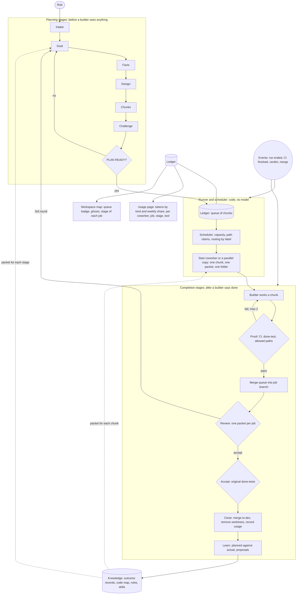

# The factory map: how the ideas of 2026-11-11 fit together and graft onto Rerun

Read [PRINCIPLES.md](PRINCIPLES.md) first: the rules this design follows, in Rob's own words.

Status: research and plan, not built. Code facts are from three read-only passes over `dev` at `145f239`
plus one on brain and memory; each fact has a file and line in issue #42. Facts marked "reading" were not
re-verified by hand and must be checked by whoever builds the item.

## 1. The one idea underneath all of them

**A rule in a prompt is a request. A stage in a pipeline is a mechanism.**

Every problem of the day had the same shape: the right behaviour was written down and depended on a model
choosing to do it. Boss's instructions already said "investigate, plan, let Devils Advocate attack the plan,
then build"; none of it ran. Brain pages exist; nobody is made to read them. A pause note was posted twice;
the session kept going. So the design moves each of these from "asked for" to "enforced by code", and keeps
model tokens for the three things only a model can do: plan, build and judge.

Four rules follow, and every part of the map obeys them:

1. Code decides what happens next; models work inside a stage.
2. Knowledge is pushed into a stage's packet, never left to be pulled.
3. Nothing counts as done without evidence a script can check.
4. Tests, waiting and routing cost no model tokens.

## 2. The parts and how they relate

| Part | What it is | Feeds | Fed by |
|---|---|---|---|
| **Ledger** | One workspace-wide store: jobs, tasks, chunks, state, labels, claims, attempts, links to issue, branch, PR and runs | runner, scheduler, usage page, map | every stage, every event |
| **Runner** | The state machine. Starts the right coworker for a stage with that stage's packet and skill, validates the output, runs the exit check, moves the job or sends it back | every stage | events, ledger |
| **Stage skill + schema** | The procedure for one stage and the exact shape of its output | the coworker in that stage | Learn stage (gated changes) |
| **Planning department** | The workers of the planning stages: goal (IKE), facts (Code Mapper, on SymForge), design by label (ADA, GRACE, CODD, DIETER, HOLMES), chunks (Scope Shaper as chunker), challenge (Devils Advocate), plan keeping (Planner). Idea Partner and Prior Art Scout sit before Intake | the plan | Rob, the runner |
| **Chunker** | A strong model, once per job: contract first, then a graph of chunks with allowed paths, dependencies, done-test and labels. A chunk is right when a small model can finish it from its packet alone | scheduler | facts, design |
| **Scheduler** | The load balancer. Hands out a chunk when its dependencies are merged, no running chunk claims its paths, shared things (a migration number, a lock file) are free, and capacity allows (memory, one heavy build at a time, the week's pace). Routes by label: Jev, with a rule table as fallback | builders | ledger, capacity readings |
| **Parallel copies ("ghosts")** | A copy of a named coworker for one chunk: same instructions and model, its own session and working folder. Spawned by the scheduler; a coworker may ask. Drawn see-through beside the real tile; a queue badge shows pressure; "waiting for capacity" shows the bottleneck | throughput | scheduler |
| **Proof loop** | CI is the test. The gate reads GitHub and decides. Builder and reviewer read results; nobody runs suites by hand | integrate | CI, `tools/factory/gate` |
| **Review queue** | Collects a job's chunks into one packet; routes by risk; a verdict is bound to the commit that was read; re-review covers only the change since | accept | merge queue, `risk`, `review` |
| **Run control** | Truthful run records, who started what, coworker status over all live runs, stop and pause from Boss, token ceiling per run | everything that acts on a live run | engine seams |
| **Usage** | Tokens by kind (fresh input, output, cache write, cache read) and share of the weekly allowance, never one without the other, never money. Per coworker, copy, job, stage, tool, model and thinking level | Rob, the scheduler's pacing, the Learn stage | step tables that already exist, weekly reading |
| **Settings** | Per coworker: model (exists), thinking level, model for helper sessions | cost and quality | usage figures |
| **Tool-server state** | LED per server, tool count, reconnect; automatic redial and retry | builders keep working after an update | engine status call that already exists |
| **Knowledge** | Outcome records from every job, linked to the code map; rules per repo; skills per stage. Selected by label and put into packets | every stage | Learn stage, SymForge |
| **Worktree register** | Who owns which worktree, for which job, since when; removal only through the safe path; a sweep with a policy | disk, cleanup | scheduler, close stage |

## 3. Where each of Rob's ideas lands

| Idea (Rob, 2026-11-11) | Part | Issue |
|---|---|---|
| Which coworkers use the most; "point to a culprit"; granular; no money; tokens and weekly share | Usage | #40 |
| Collection that costs no tokens | Usage reads the engine's own step tables | #40 |
| Thinking level and helper-session model per coworker | Settings | #40 follow-up |
| Reconnect control, LED, tool count | Tool-server state | #41 |
| Smaller pieces, parallel worktrees, faster commits, queued review | Chunker, scheduler, proof loop, review queue | #42 F1-F5 |
| "Keep note of which worktrees are not needed" | Worktree register and sweep | #42 F6, branch `factory/safe-worktrees` |
| "Workers spun on demand"; keep named coworkers, copy the bottlenecked one; ghosts on the map | Parallel copies | #42 F3 |
| "A really good task/ledger chunker"; Jev routes on labels | Chunker, ledger, scheduler | #42 F1, F2 |
| "Planning should be 70% of our work"; a Planning department | Planning stages and their workers | #42 P0 |
| "Milestones, sprints, tasks, subtasks, loops for reviews and proofs" | Ledger levels and the bounded loops | #42 |
| "Automagically ... before it even reaches the workers. and same goes for when work is completed" | Runner, stage skills, exit checks | #42 P0 |
| "Brain ... a graveyard"; knowledge graph, memory layer, injection, always-improving agents | Knowledge, Learn stage | section 5 below |
| "Tests should cost 0 tokens" | Proof loop; CI runs the layout tests | team rule; testpilot #193 |
| "No limit should stop us"; add-ons first; decide on a split when a wall is hit | Grafting rings | section 4 |

## 4. Grafting onto Rerun: three rings

**Ring 1, beside the engine. No change to Rerun's own files.**
- The runner and scheduler as a small service next to the engine. It starts coworker runs through the engine's
  existing message route and reads results from GitHub and the per-coworker run tables.
- The ledger in its own database file. It moves into the engine's workspace database only if that proves worth it.
- `tools/factory`: lock and cap, memory check, register, sweep, `review --sha`, merge queue, chunk graph checks.
- Stage skills, stored as ordinary Rerun skills.
- Usage gathering: a job that reads every coworker's step tables into one workspace table.
- CI workflows in each product repo.
- New screens (usage, job pipeline) as new files in the UI.

**Ring 2, thin seams. One small, named change in the engine each; candidates to offer upstream.**

| Seam | Where (reading) |
|---|---|
| Live step and token counts for Claude and Codex runs | `runtime/run-stream-merge.ts`, `agents/claude-stream.ts`, `db/repos/runs.ts` |
| Run lineage: which run started this run | `db/repos/runs.ts` `startRun`, `runtime/context.ts` `RunTrigger`, `tools/builtin/call-agent.ts` |
| Coworker status counted over all live runs | `runtime/loop.ts:347` |
| A tool to cancel or pause another run, with permission | beside `call_agent`; `runtime/run-control.ts` `abortRun` |
| Token ceiling per run | `runtime/loop.ts` `stopWhen`; `agents/providers.ts` options |
| A local listener when a run ends | `runtime/loop.ts` `settle`, after `emitRunTerminal` |
| Session id on a trigger fire | `packages/contracts/src/trigger.ts`, `runtime/trigger-runner.ts` |
| Thinking level per coworker | `packages/contracts/src/agent.ts`, `agents/providers.ts:315` |
| Model for helper sessions | `tools/builtin/delegate.ts:85` |
| Session labels in the launch environment | `agents/providers.ts` `resolveModel` to `claudeProvider` |
| A per-run knowledge packet in the prompt | `agents/systemPrompt.ts` volatile list, or the per-turn suffix in `runtime/loop.ts` |
| An outcome record when a run ends | `runtime/loop.ts` `settle`, after `finishRun` |
| Tool list in the server status reply; redial on demand | `tools/mcp.ts` `probeMcp`, `tools/mcp-status.ts`, `tools/mcp-pool.ts` |

**Ring 3, deep changes. The engine's design is in the way. These are the only candidates for a wall.**

| Change | Why it is deep | Needed for |
|---|---|---|
| A working folder per run | Today one folder, one memory, one private database and one tool-server process per coworker | parallel copies |
| Deliver a message into a live session | Today a new session is created, or the message is refused while the session is busy | steering, fewer duplicate sessions |
| Resume after an engine restart | Run state is process memory; running rows are failed on start; sessions are never resumed | deploying Rerun without killing work |
| More than one machine | The engine assumes one process on one server | capacity beyond one server |

**Keeping the fork cheap.** A patch ledger (one file listing every engine file we changed and why); seams kept to
hooks with our logic behind them; upstream merged on a schedule with CI. The split question is taken up on
evidence at two points: after milestone 2 (the seams are in; did they stay thin?) and before the first Ring 3 change.

## 5. Knowledge: what exists and what the graft is

What the engine has (reading): a workspace brain of markdown pages with search (vector plus keyword) and
`[[links]]`, one hop only; per-coworker memories with decay and a top-5 recall added to each user message;
per-coworker skills listed by name; a curator that saves at most one memory per chat run; skill and brain
proposals that a person accepts. What goes into a prompt by itself: the brain's index (titles, capped) and the
company card, the memory headlines, the skill names. Page bodies, skills and shared files are fetched only if
the model calls a tool. Nothing records that a brain page or a skill was ever read, though every tool call is
stored and can be mined. Self-improvement is forced off in runs one coworker starts in another, which is how
almost all factory work runs. No path carries one coworker's lesson to another except a brain proposal a
person approves.

The graft:
1. **Push.** The runner builds each stage's packet and selects knowledge by the chunk's labels (repo, area, kind). Seam: the per-run packet in the prompt. Pages need a label; the page type or a slug prefix is the cheapest.
2. **Records, not prose.** The Close stage writes a structured outcome per chunk and job: what was touched, what failed, why it came back, which decision settled it, tokens by kind. Linked to the code map. Seam: the outcome record.
3. **A gated improvement loop.** The Learn stage turns outcomes into proposals (a rule for a repo, a change to a stage skill) through the proposal mechanism that already exists; a proposal is applied after a check, and its effect is measured on the next jobs (first-time pass rate, review rounds, tokens).
4. **Measure reading.** Mine the stored tool calls for brain and skill reads per run, so "nobody reads it" becomes a number; then archive pages nothing refers to.

## 6. Milestones

Each has an outcome a person can see. Later ones depend on earlier ones as shown.

| # | Outcome | Contents | Ring |
|---|---|---|---|
| **M0** (in progress) | The factory stops losing work; tests run in CI | `factory/safe-worktrees`; testpilot #193; "plan before build" and "tests cost 0 tokens" in the team rules; wave-0 fact-finding | 1 |
| **M1** | No job reaches a builder without a checked plan, by mechanism | Ledger; runner v1 driving the planning stages; stage skills and schemas for Goal, Facts, Design, Chunks, Challenge, Ready; Planning department formed; Code Mapper on the new SymForge; Boss dispatches only from the ledger | 1 |
| **M2** | Runs are truthful and stoppable; usage is visible | Seams: live counts, lineage, status, cancel and pause, ceiling. Usage table and page v1 with the weekly reading. Thinking level setting. Tool-server LED and reconnect | 1, 2 |
| **M3** | Completion runs itself | Proof, Integrate, Review queue, Accept, Close stages; merge queue; local run-ended listener; GitHub events; automatic sweep; two-tier CI (fast per chunk, full per job) | 1, 2 |
| **M4** | Work runs in parallel safely | Chunker quality loop; scheduler with capacity and claims; Jev routing; working folder per run; ghosts and queue badge on the map | 1, 2, 3 |
| **M5** | The team learns | Knowledge packets; outcome records; gated improvement; brain clean-up; reading measured | 1, 2 |
| **M6** | Survives restarts, grows past one server | Deliver into a live session; resume; remote workers | 3 |

Dependencies: M1 needs nothing from the engine. M3 needs M2's lineage and listener. M4 needs M1's chunk graph,
M2's truthful status and M3's merge queue. M5 needs M3's Close stage. M6 stands alone and is where the split
question is most likely to be answered.

## 7. Limits that are not code

- **The server.** One machine with a fixed number of cores and a fixed amount of memory. Parallel copies that write code fit; parallel local builds do not. Tests in CI first, then more copies.
- **The weekly allowance.** More copies burn it faster. The scheduler paces against it; it cannot create it.
- **Dependencies in the work.** The chunker shrinks sequential work by cutting contracts first; it cannot remove it. Chunks also have a minimum useful size (session start, PR, CI run).

## 8. Decisions waiting for Rob

1. Review verdicts are not authenticated, and `merge-dev` checks CI only. Enforcing both changes how the team works today.
2. Raising the builder cap from 2, and to what, once tests are in CI.
3. A "Planning" Box and attaching SymForge to the planning coworkers: both are done in Rerun's interface.
4. Server capacity, once tests in CI show how much load remains.
5. The split from upstream: revisit after M2 and before the first Ring 3 change.

## 9. State of every feature (2026-11-11)

| Feature | Where | State |
|---|---|---|
| "Plan before build" and "tests cost 0 tokens" as team rules | team rule file | live as rules; not yet enforced by mechanism |
| Safe worktree removal, real builder cap with a lock, memory check, worktree register, sweep, `review --sha` | branch `factory/safe-worktrees` | being built and gate-checked |
| Browser layout tests in CI | testpilot #193 | in progress; the layout tests fail on main in several files |
| Repeat on environment failures, with the breathing "Retrying" note | testpilot #187, PR #194 | being built |
| Empty capsule band; panel on the rail's line; capsule views unchanged | testpilot #189, PR #190 | rejected twice; design being planned before any further build |
| Face-first person generation | testpilot #188 | live |
| Usage analytics: tokens by kind and weekly share, per coworker, job, stage, tool, model, thinking level | #40 | fact-finding; the collector is not needed (step tables exist) |
| Source of the weekly percentage for the plan | #40 | unknown |
| Thinking level per coworker; model for helper sessions | #40 follow-up | not filed as its own issue |
| Tool-server LED (small square, top corner), tool count, reconnect icon, automatic redial | #41 | fact-finding |
| Sessions survive a tool-server restart without a manual reconnect | terminal-commander #294 | queued |
| Job pipeline that runs itself: ledger, runner, stage skills, exit checks | #42 P0 | planned, not started |
| Planning department: regroup nine coworkers, Scope Shaper becomes the chunker, new Code Mapper and Planner, Boss dispatches only | #42 P0 | approved; instructions drafted; a Planning Box and SymForge attachment need Rerun's interface; Code Mapper waits for the new SymForge |
| Chunker, labels, ledger | #42 F1 | defined |
| Scheduler with capacity, path claims and routing | #42 F2 | defined; what Jev accepts and returns is unverified |
| Parallel copies and ghosts on the map | #42 F3 | defined; needs a working folder per run |
| Small PRs into a job branch; merge queue; two-tier CI | #42 F4 | defined |
| Review queue, one packet per job | #42 F5 | defined |
| Run control: truthful records, lineage, status over live runs, stop and pause from Boss, token ceiling | #42 A1-A4 | wave-1 plans being written |
| Message into a live session; one job, one builder; triggers on CI, verdict and merge | #42 A5-A7 | planned |
| Knowledge packets, outcome records, gated improvement, brain clean-up | this document, section 5 | not filed |
| Board change: `BOARD.md` read first with a `driver:` line, "Rules learned" per repo | approved earlier | not applied; to be folded into the ledger and the Learn stage |
| Review verdicts are not authenticated; `merge-dev` checks CI only | `tools/factory` | waiting for Rob's decision |
| Resume after an engine restart; remote workers | #42, Ring 3 | not started |

**Existing coworkers whose jobs overlap the new parts.** They keep their names and become the people side of a mechanism:
Warden (usage watchdog) reads and comments on the usage page instead of collecting; Botsitter (completion checker) is replaced
in its checking by the Proof stage's script and keeps the cases the script cannot decide; Box Janitor (server health) runs the
worktree sweep and reports capacity readings to the scheduler; Agent Smith (workspace tidiness) runs the brain clean-up and the
audit of unread pages and unused skills.

## 10. The factory's KPIs

Rob, 2026-11-11: "as in any factory, you have rules, regulations, procedures, automated steps and people or robots to
manage it all so a product churn is smooth and KPI stays green. Here instead of people and robots we have our LLMs."

Every figure is read from the ledger and the step tables; none is reported by a coworker. Each has a green range that is
set after two milestones of real numbers, not guessed now.

| KPI | What it tells | Source |
|---|---|---|
| First-time pass rate of chunks | whether chunks are cut right for the model that builds them | Proof stage |
| Review rounds per task | whether plans are good enough before building | Review stage |
| Returned-to-planning rate | plans that were wrong | ledger |
| Planning share | tokens spent in planning stages against building, per job (target: the larger share) | usage by stage |
| Lead time per chunk and per job | from Ready to merged | ledger |
| Queue age and work in progress | where work waits, and for what: a coworker, capacity, a review | ledger, scheduler |
| Tokens per merged chunk, by kind | cost of a unit of output | usage |
| Waiting tokens | tokens spent while a command ran (target: zero) | step tables |
| Weekly pace | share of the weekly allowance used against the day of the week | weekly reading |
| Stuck and orphan runs | runs live with no step for a set time; sessions nobody started through the runner | run records, lineage |
| Escaped defects | problems found after Accept, traced to the stage that should have caught them | Learn stage |
| Knowledge use | packets delivered, and brain and skill reads per run | stored tool calls |

## 11. Build the least: "the best part is no part"

Rob, 2026-11-11: "overengineering is a curse and a blight. As Elon Musk says 'the best part is no part'."

This map is the whole picture, not a build list. Rules for what actually gets built:

1. **A part is built only when a measured failure demands it**, and the failure is named on its issue.
2. **Prefer a check at a choke point over a new service.** Builders already pass through `wt new`, `pr-open` and `merge-dev`; a check there costs a few lines and no new moving part.
3. **Every new part must delete something**: a section of a prompt, a manual step, a coworker's duty, a script.
4. **No part is built for a later milestone's sake.** If M1 works with a table in a file, it has no service.
5. **The result must be superior at a lower cost** (Rob, 2026-11-11: "the resulting product must be superior at a lower cost"). Simpler is not the goal; better and cheaper is, and both are measured:
   - **Better:** first-time pass rate up, review rounds and returned-to-planning down, no defect found after acceptance.
   - **Cheaper:** tokens per merged job down (by kind), and a smaller share of the weekly allowance per job.
   - **Baseline first.** Before a part is built, the same figures are taken for comparable jobs done the old way (`job-cost` already sums tokens per job from the stored step data). No baseline, no claim.
   - **Keep or remove.** After a part has run on real jobs, it stays only if quality rose without cost per job rising, or cost fell without quality falling. A part that fails both tests is removed, and the removal is recorded.
   - A cheaper process that ships worse work, and a better one that burns the week, both fail.

**The smallest version that would have prevented the failures of 2026-11-11**

| Failure | Smallest fix | New parts |
|---|---|---|
| Work went to builders without a plan | `wt new` refuses unless the job's issue carries `PLAN READY` (or a one-line "no plan needed because") | none: one check in an existing script |
| Three sessions on one branch | the worktree register records the owner; `wt new` refuses a second owner | none beyond M0 |
| Unpushed work could be deleted | safe removal | none beyond M0 |
| Tests run by hand, millions of tokens | the tests run in CI | one CI job per repo |
| A session could not be stopped by Boss | a cancel tool beside `call_agent` | one seam |
| Nobody could see what burned the tokens | one query over the step tables that exist, shown as a table | one screen, no collector |

That is the first thing to build, and it is M0 plus three small items. The runner service, the ledger database, the
scheduler, parallel copies, Jev routing, the knowledge packets and everything in Ring 3 wait until these are in and the
numbers show what still hurts.

**Things to delete as parts arrive**
- Boss's instructions are about 27,000 characters, much of it procedure a script will own. Each mechanism that lands removes its section from that prompt.
- Thirty-eight coworkers, several with overlapping duties. A coworker whose duty a script takes over loses that duty, and one left with none is retired.
- KPIs: start with four (first-time pass rate, review rounds, planning share, weekly pace). The other eight in section 10 are added only when one of the four cannot explain a problem.

## 12. The win condition and the self-correcting line

Rob, 2026-11-11: "Win condition is a superior product at a lower cost and grater speed. 3 metrics that should be tracked,
analyzed from input to output. Changes proposed, changes made, monitored again, gaging the results, pivoting when needed.
A selfcorecting line". He put his local Claude in charge of making it happen.

**Three metrics, per job, from the request to the merged and deployed result**

| Metric | Measured as | Source |
|---|---|---|
| **Quality** (superior product) | first-time pass rate of chunks; review rounds and rejections; returns to planning; defects found after acceptance | Proof and Review results on GitHub, the issue trail |
| **Cost** (lower) | tokens by kind per merged job, and the job's share of the weekly allowance | the stored step data (`job-cost`), the weekly reading |
| **Speed** (greater) | lead time from request to merged, split into planning, waiting for a builder, building, CI, waiting for review, review, rework | timestamps of issue, runs, commits, CI and merge |

All three are read from records. None is reported by a coworker.

**The loop**
1. **Measure.** When a job closes, a script writes its three metrics and a "why" report: number of model calls, context size over the run, the largest tool outputs, repeated commands, rejected rounds, where the time went.
2. **Analyze.** Compare with the baseline (the old-process baseline is on issue #42) and name the largest cause.
3. **Propose.** One change at a time, aimed at that cause, with the metric it should move and by how much.
4. **Change.** The smallest version, at a choke point where possible (section 11).
5. **Monitor.** The next comparable jobs are measured the same way.
6. **Keep, adjust or pivot.** A change that moved its metric without hurting the other two stays. One that did not is removed or reworked, and the outcome is recorded here.

A change that makes one metric better by making another worse does not count as a win.

**Change log of the line** (append only; one row per change)

| Date | Change | Aimed at | Expected | Measured result |
|---|---|---|---|---|
| 2026-11-11 | "Plan before build" as a team rule | quality, cost: three rejected builds of one job (about 49M tokens) | no build without a challenged plan | pending |
| 2026-11-11 | Additions to a running job go on the issue, not as a new dispatch | cost: about 11M tokens in duplicate sessions | no duplicate sessions per branch | pending |
| 2026-11-11 | Browser layout tests run in CI (testpilot #193) | cost, speed: a reviewer built and ran them by hand (about 24M tokens) | reviewers read a result instead of producing it | pending |
| 2026-11-11 | Safe worktree removal, real builder cap, register and sweep (`factory/safe-worktrees`) | quality: work could be deleted, builders collided | no lost work, no shared worktree | pending |

**Next changes, in order** (each gets a row above when made)
1. `wt new` refuses a job without `PLAN READY` on its issue: the planning rule becomes a mechanism.
2. The "why" report and the three metrics from `job-cost`, written when a job closes.
3. The starting context of a coworker taken apart and cut (issue #40): about 40,000 tokens are loaded before any work.
4. A cancel tool for Boss beside `call_agent`.
5. Reassess with the numbers before building anything further from this map.
